* Table of Contents 
{:toc}


## Acknowledgements

- This project is based on the [AddressBook Level 3](https://github.com/se-edu/addressbook-level3) project created by the [SE-EDU initiative](https://se-education.org).

### Notable uses of AI

- OpenAI Codex was used by Piyaphat Klanprayoon throughout the project to assist with planning code changes and,
  in some cases, implementing them. It also assisted with running tests, comparing proposed changes against the
  existing codebase, and suggesting relevant software-engineering and testing practices. Piyaphat reviewed and
  adapted proposed changes before raising them for peer review, ran and reviewed relevant tests for submitted
  changes, and remains responsible for the submitted work.

- OpenAI Codex was used by Min Rui throughout the project to assist with with evaluating design decisions, 
identifying documentation inconsistencies, and suggesting relevant coding and testing practices. Additionally, 
it aided in running tests and comparing proposed modifications against the existing codebase. AI-generated 
suggestions were reviewed and adapted against the existing codebase and project requirements before incorporation 
into the submitted work.

## Setting up, getting started

Refer to the guide [_Setting up and getting started_](SettingUp.md).


## Design

This section describes TAssist's architecture and the responsibilities of its main components. It also explains how the components collaborate to support student management, course enrolments, deliverable tracking, and data persistence.

The PlantUML source files for the diagrams are located in `docs/diagrams`.

### Architecture

TAssist follows a component-based architecture comprising `Main`, `UI`, `Logic`, `Model`, and `Storage`. The `Commons` package provides shared utilities used across components.

The following architecture diagram illustrates the main components and their dependencies.


The **`Main`** component consists of `Main` and `MainApp`. It is responsible for launching TAssist, initializing and connecting the other components, and coordinating application shutdown.

The four main components have distinct responsibilities:

| Component | Responsibility |
|---|---|
| `UI` | Handles user interaction and presents application data. |
| `Logic` | Parses and executes user commands. |
| `Model` | Maintains application data and enforces domain constraints. |
| `Storage` | Loads and persists application data in JSON files. |

`Commons` contains shared functionality, including logging, file utilities, and common exceptions.

#### Component interactions

The following sequence diagram illustrates how the main components collaborate when executing `delete /id A1234567B`.

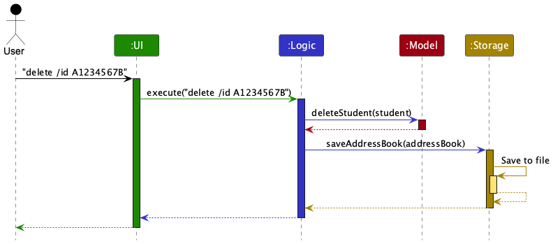

The `UI` forwards the command to `Logic`, which executes the corresponding operation against `Model`. After successful command execution, `Logic` requests `Storage` to persist the address book before returning the result to `UI`.

The diagram intentionally abstracts the internal parsing, command execution, and JSON serialization steps. These are explained in the component-specific sections.

#### Component interfaces and implementations

Each major component exposes its functionality through an interface and provides a concrete manager implementation.

For example, `LogicManager` implements the `Logic` interface, while `ModelManager` and `StorageManager` implement `Model` and `Storage` respectively.

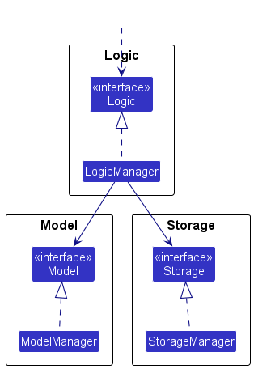

This separation allows components to depend on public APIs rather than the internal implementation of another component. It also supports testing by allowing alternative implementations of component interfaces.

### UI component

**API:** `Ui.java`

The `UI` component uses JavaFX to handle user interaction and display information maintained by TAssist.

The following class diagram illustrates the structure of the UI component.

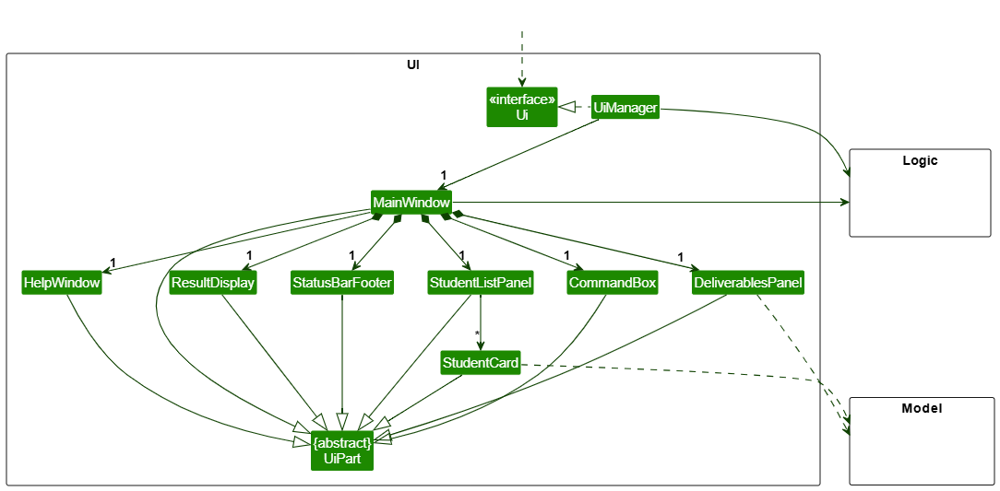

`UiManager` implements the `Ui` interface and manages the application's main window.

`MainWindow` coordinates several UI parts, including:

- `CommandBox`, which accepts user commands.
- `ResultDisplay`, which displays command feedback.
- `StudentListPanel`, which displays student records through `StudentCard` instances.
- `DeliverablesPanel`, which displays structured deliverable-progress information.
- `StatusBarFooter`, which displays application status information.
- `HelpWindow`, which provides command guidance.

These UI classes inherit from the abstract `UiPart` class, which provides shared functionality for JavaFX UI components.

UI layouts are defined using FXML resources, while their corresponding Java classes handle interaction and presentation logic.

The `UI` component communicates with `Logic` to execute commands and retrieve application data. It also uses Model types when rendering students and deliverable-progress information.

### Logic component

**API:** `Logic.java`

The `Logic` component interprets user commands, executes the corresponding operations, and returns their results.

The following class diagram shows the main structural relationships within Logic.

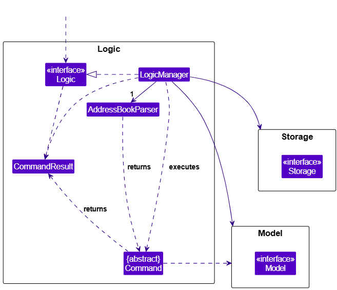

`LogicManager` implements the `Logic` interface and coordinates command execution.

It uses `AddressBookParser` to convert command text into a `Command` object. The command is then executed against `Model`, producing a `CommandResult`.

`LogicManager` also interacts with `Storage` to persist the address book after successful command execution.

#### Command execution

The following sequence diagram illustrates the execution of `delete /id A1234567B`.

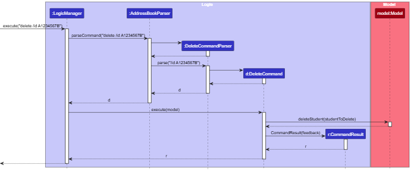

The command execution proceeds as follows:

1. `LogicManager` passes the command text to `AddressBookParser`.
2. `AddressBookParser` creates the appropriate command-specific parser, `DeleteCommandParser`.
3. `DeleteCommandParser` parses the arguments and creates a `DeleteCommand`.
4. `LogicManager` executes the returned command against `Model`.
5. `DeleteCommand` identifies the target student and invokes `Model.deleteStudent(...)`.
6. The command creates and returns a `CommandResult`.

The diagram focuses on the internal Logic execution path. Student lookup details, exception handling, and persistence are omitted to keep the interaction focused. Persistence is represented in the architecture sequence diagram.

#### Command parsing

The parser subsystem separates command identification from command-specific argument parsing.

The following partial class diagram illustrates the shared parsing architecture.

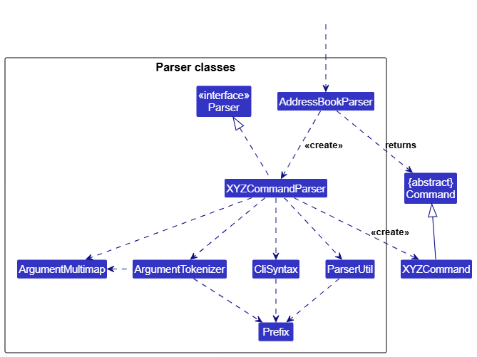

`AddressBookParser` identifies the command word and delegates argument parsing to the appropriate parser.

Command-specific parsers use shared infrastructure such as:

- `ArgumentTokenizer` to separate arguments into prefixed values.
- `ArgumentMultimap` to store and retrieve tokenized arguments.
- `ParserUtil` to validate and convert argument values.
- `CliSyntax` and `Prefix` to define command parameter syntax.

In the diagram, **`XYZCommandParser` and `XYZCommand` are representative placeholders**, not actual Java classes. They illustrate the general relationship between a command-specific parser and the command it creates. For example, `SearchCommandParser` creates a `SearchCommand`.

The diagram intentionally omits specialized parser inheritance relationships. For example, progress commands share parsing behavior through `StudentProgressCommandParser`, which is extended by `MarkCommandParser` and `UnmarkCommandParser`.

This design allows common parsing and validation behavior to be reused while retaining command-specific parsing responsibilities.

### Model component

**API:** `Model.java`

The `Model` component maintains TAssist's in-memory application data and provides operations for managing students, courses, enrolments, and deliverable progress.

The following class diagram illustrates its main structural relationships.

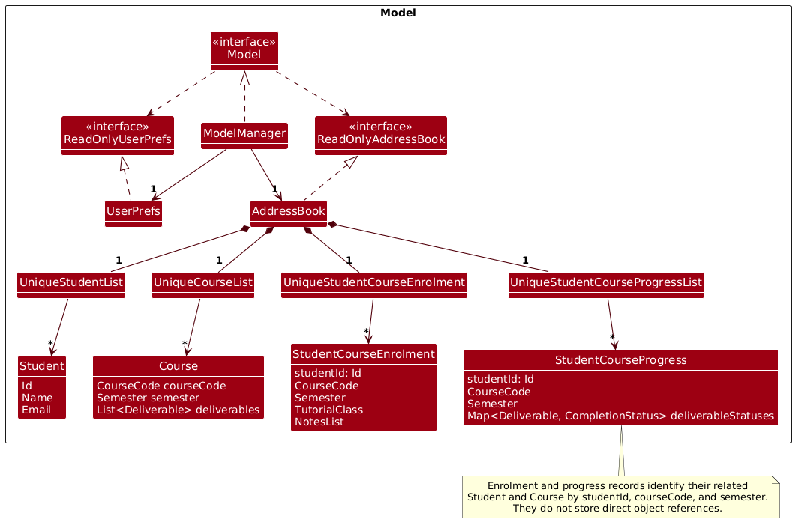

`ModelManager` implements the `Model` interface and maintains an `AddressBook` and a `UserPrefs` object.

`AddressBook` organizes domain records through four specialized collections:

| Collection | Stored records |
|---|---|
| `UniqueStudentList` | `Student` |
| `UniqueCourseList` | `Course` |
| `UniqueStudentCourseEnrolment` | `StudentCourseEnrolment` |
| `UniqueStudentCourseProgressList` | `StudentCourseProgress` |

These collection classes encapsulate record management and enforce uniqueness constraints.

The `Model` interface exposes read-only interfaces such as `ReadOnlyAddressBook` and `ReadOnlyUserPrefs`. This separates data access from the mutable operations provided by their concrete implementations.

The Model also maintains a filtered student list, exposed through an unmodifiable observable list. This allows the UI to observe changes without directly modifying the underlying student collection.

#### Multiple course enrolments and independent progress

TAssist separates student identity from course enrolment and deliverable progress.

A `Student` represents a student independently of their course registrations. Each `StudentCourseEnrolment` identifies the student and a particular course-semester, while a corresponding `StudentCourseProgress` records completion statuses for that course's deliverables.

The following object diagram shows a concrete snapshot of one student enrolled in two courses.

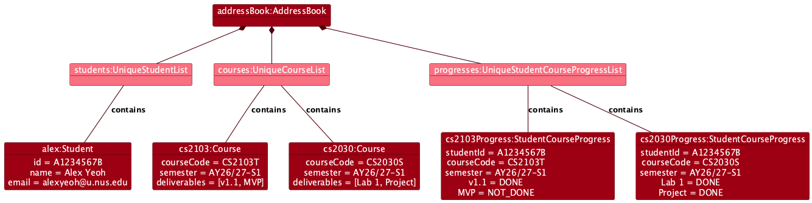

The snapshot demonstrates that:

- One student record can be associated with multiple enrolments.
- Each enrolment belongs to a particular course-semester.
- Each course defines its own deliverables.
- Progress is tracked independently for each student-course-semester combination.

The model uses identifying values such as student ID, course code, and semester to associate these records, rather than storing direct references between all domain entities.

This separation avoids duplicating student information across courses and allows progress to be maintained independently for each enrolment.

### Storage component

**API:** `Storage.java`

The `Storage` component manages the persistence of TAssist's address-book data and user preferences.

The following class diagram illustrates its structure.

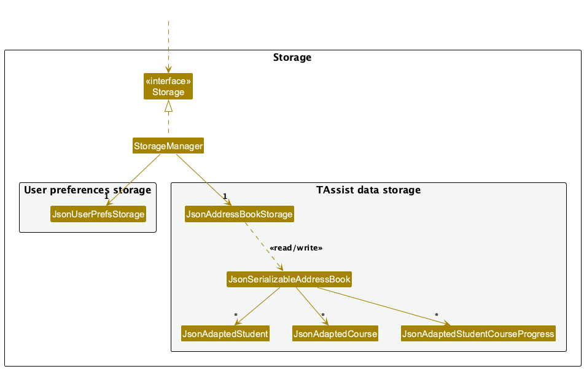

`StorageManager` implements the `Storage` interface and delegates file operations to two specialized storage classes:

- `JsonAddressBookStorage`, which manages address-book data.
- `JsonUserPrefsStorage`, which manages user preferences.

`JsonAddressBookStorage` uses `JsonSerializableAddressBook` to convert between JSON data and the Model representation.

The JSON representation includes adapters for students, courses, enrolments, and progress records.

#### Loading address-book data

When TAssist starts, `MainApp` requests the saved address book through `StorageManager`.

The following sequence diagram illustrates the successful loading interaction.

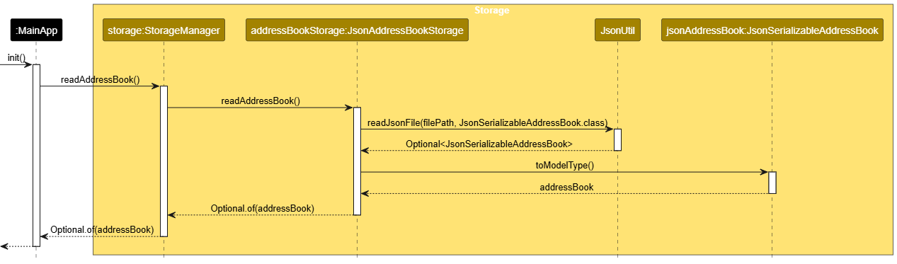

`StorageManager` delegates loading to `JsonAddressBookStorage`, which uses `JsonUtil` to deserialize the JSON file into `JsonSerializableAddressBook`.

The deserialized data is then converted into an `AddressBook` through `toModelType()`, which validates the persisted records and their relationships.

The sequence diagram intentionally focuses on successful object collaboration. Missing files, invalid data, and startup failure handling are explained separately below.

#### Storage loading outcomes

TAssist distinguishes a missing data file from an existing file that cannot be loaded safely.

The following activity diagram summarizes the startup outcomes.

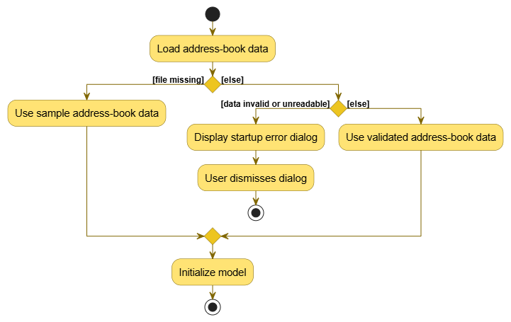

| Storage condition | Behaviour |
|---|---|
| Address-book file is missing | Initialize the application with sample data. |
| Existing file is valid | Load the saved address book. |
| Existing file contains reconcilable progress differences | Reconcile and persist the corrected progress before normal startup. |
| Existing file is malformed or contains invalid records | Reject loading and stop normal startup. |
| Existing file cannot be read | Stop normal startup and report the loading failure. |

An invalid existing file is **never treated as a missing file**.

This distinction prevents TAssist from silently replacing user data with sample data when loading fails.

When loading fails, TAssist displays a JavaFX error dialog and exits after the user dismisses it. Normal command execution is not initialized, preventing subsequent commands from overwriting the invalid address-book file.

#### Progress reconciliation

TAssist applies a limited reconciliation policy to progress records whose deliverables differ from those currently defined by their course.

The following activity diagram illustrates the reconciliation workflow and its persistence safeguards.

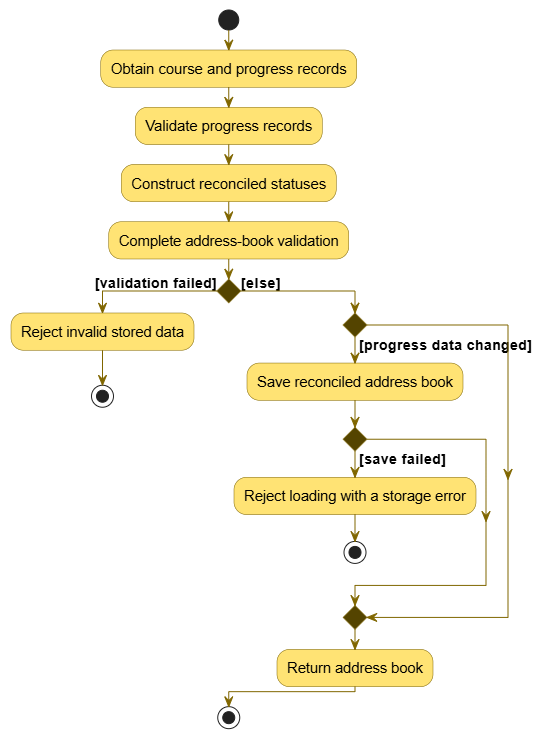

During conversion, progress statuses are aligned with the deliverables defined by the corresponding course.

| Situation | Reconciliation behaviour |
|---|---|
| Stored deliverable matches a course deliverable | Preserve its existing completion status. |
| Course deliverable is missing from progress | Add it with status `NOT_DONE`. |
| Stored progress contains an unknown deliverable | Exclude it from the reconciled record. |
| Deliverable differs only in capitalization | Match case-insensitively and preserve its status. |
| Progress records are already consistent | Do not unnecessarily rewrite the storage file. |

For example, suppose a course defines `MVP` and `Final`, but the saved progress contains:

```json
{
  "mvp": "DONE",
  "Old": "NOT_DONE"
}
```

The reconciled progress becomes:

```json
{
  "MVP": "DONE",
  "Final": "NOT_DONE"
}
```

The valid `MVP` status is preserved, the missing `Final` status is initialized as `NOT_DONE`, and the obsolete `Old` entry is excluded.

Reconciliation is tracked during conversion, and the final reconciliation state is recorded only after successful validation.

The activity diagram separates validation and reconciliation into conceptual actions for readability. In the implementation, some validation occurs while individual progress records are being reconciled.

**Reconciliation is not a general corruption-recovery mechanism.** Invalid references, duplicate records, invalid notes, and malformed data are rejected rather than silently corrected.

#### Persistence safety and failure handling

Reconciled data is saved only after successful model conversion and validation.

If no reconciliation is required, the existing address-book file is not unnecessarily rewritten.

TAssist also uses a temporary-file write strategy to reduce the risk of corrupting existing data during saving:

1. Write the new JSON content to a temporary file in the target directory.
2. Replace the original file after the temporary content has been written successfully.
3. Use atomic replacement where supported, with a non-atomic replacement fallback where necessary.
4. Clean up temporary files after failures where possible.

If saving reconciled data fails, loading reports a `DataLoadingException` instead of treating persistence as successful.

The non-atomic fallback cannot guarantee protection against every interruption. Likewise, reconciliation may intentionally discard completion statuses associated with unknown deliverables, because TAssist cannot safely infer how an obsolete deliverable maps to a current one.

These behaviors are deliberate storage policies that future developers should preserve or explicitly reconsider when modifying persistence logic.

---

## Implementation

This section explains noteworthy TAssist-specific workflows and the design decisions behind them.

### Course initialisation

The `init course` command establishes the course-semester and deliverable definitions used by subsequent enrolment and progress-tracking operations.

`InitCourseCommandParser` parses the course code, semester, and requested deliverables before constructing an `InitCourseCommand`.

A course is identified by its `CourseCode` and `Semester`. Its deliverables define the milestones against which student progress is tracked.

`UniqueCourseList` prevents duplicate course-semester records, while the Model API provides operations such as `hasCourse()` and `addCourse()`.

Persisting course definitions alongside the other address-book records ensures that course information remains available after restarting TAssist.

### Updating deliverable progress

`MarkCommand` and `UnmarkCommand` share their execution workflow through `StudentProgressCommand`.

The commands differ in the target completion status:

- `mark` updates requested deliverables to `DONE`.
- `unmark` updates requested deliverables to `NOT_DONE`.

The following activity diagram illustrates the shared workflow.

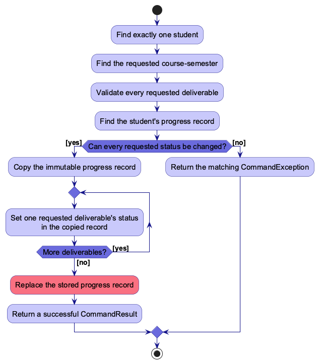

The command first identifies exactly one student and the requested course-semester. It then validates the requested deliverables, retrieves the matching progress record, and checks its current completion statuses.

`StudentCourseProgress` is immutable. Therefore, the command uses `withStatus(...)` to construct updated progress records rather than mutating the existing stored record.

Only after all required checks and updates succeed does the command replace the original record through the Model API.

This ensures that failed validation does not leave a partially updated progress record in the Model.

The diagram combines the validation outcomes into a single decision for readability. In the actual implementation, a failed lookup or validation throws `CommandException` immediately.

### Viewing student deliverables

The `view` command retrieves the deliverable progress associated with a selected student across their enrolled course-semesters.

`ViewProgressCommand` identifies the student and collects matching `StudentCourseProgress` records.

For students with available progress records, the command constructs a `StudentDeliverablesView` containing the selected student and an immutable list of their progress records.

The view is included in `CommandResult`, alongside the textual feedback.

The following sequence diagram illustrates how this structured result reaches the UI.

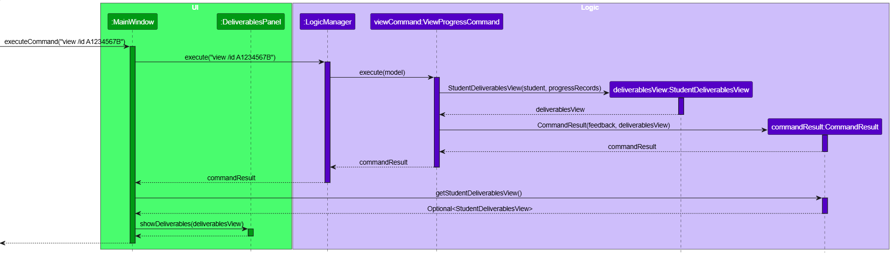

`MainWindow` receives the `CommandResult` from Logic and retrieves its optional `StudentDeliverablesView` payload.

When the payload is present, `MainWindow` passes it to `DeliverablesPanel` through `showDeliverables(...)`.

The diagram illustrates a successful view operation with progress records. Parser interactions, Model lookups, Storage persistence, student-list scrolling, and the empty-progress case are intentionally omitted to focus on the structured-result handoff.

#### Design consideration: structured UI data

Two approaches were considered for passing deliverable information to the UI.

| Approach | Advantage | Drawback |
|---|---|---|
| Parse formatted command feedback in the UI | Avoids introducing another result type | Couples UI behavior to the wording and formatting of feedback messages |
| Include a structured view in `CommandResult` | Provides strongly typed data independent of feedback formatting | Requires an additional view representation |

TAssist uses the second approach.

This separates the textual feedback shown in `ResultDisplay` from the structured progress data consumed by `DeliverablesPanel`.

As a result, changes to feedback wording do not require the panel to change how it interprets deliverable information.

---

## Common classes

Classes shared by multiple components are located in the `seedu.address.commons` package.

These include utilities and common types supporting logging, file operations, exception handling, and application configuration.

Keeping shared functionality in Commons avoids duplicating cross-cutting infrastructure within the individual components. 


## Documentation, logging, testing, dev-ops

* [Documentation guide](Documentation.md)
* [Testing guide](Testing.md)
* [Logging guide](Logging.md)
* [DevOps guide](DevOps.md)


## Appendix: Requirements

### Product scope

**Target user profile**:
University teaching assistants supporting computing modules with multi-week programming projects, particularly those managing students across multiple courses or tutorial classes.

**Value proposition**:
Managing many students can make it difficult for teaching assistants to keep track of individual progress and previous observations. TAssist centralises student information, course enrolments, project deliverable progress, and project-work notes, enabling TAs to monitor students more efficiently and provide contextualised academic support.


### User stories

Priorities: High (must have) - `***`, Medium (nice to have) - `**`,
Low (unlikely to have) - `*`

#### Current release user stories

| Priority | As a … | I want to … | So that I can … |
| -------- | ------ | ------------ | --------------- |
| `***` | TA | view all students under my supervision | keep track of the students I manage |
| `***` | TA | add a student to my records | maintain accurate student records |
| `***` | TA | search for a student in my records | quickly retrieve their information |
| `***` | TA | update a student’s details | keep student information up to date |
| `***` | TA | remove a student from my records | keep my student list relevant |
| `***` | TA | initialise a course and its project deliverables | track progress against the course's milestones |
| `***` | TA | 	manage a student's course enrolments | keep course registrations accurate |
| `***` | TA | view students’ progress | identify completed and outstanding deliverables |
| `***` | TA | view a course progress overview | compare progress across students in a course-semester |
| `***` | TA | mark a student’s project deliverable as completed | record the student’s progress |
| `***` | TA | unmark a completed deliverable | correct an inaccurate progress record |
| `**` | TA | record a note about a student’s project work | remember observations about their progress |
| `**` | TA | view a student’s project-work notes | recall previous observations and interactions |
| `**` | TA | delete an outdated or incorrect project-work note | keep the student’s record accurate |
| `**` | TA | view students in a selected tutorial class | prepare for a specific tutorial session |

#### Future user stories

| Priority | As a … | I want to … | So that I can … |
| -------- | ------ | ------------ | --------------- |
| `*` | TA | record a student’s attendance | identify students who may require additional support |
| `*` | TA | track follow-up actions for a student | prioritise and monitor support actions |
| `*` | TA | generate a progress report | review an overview of student performance |


### Use cases

**Actor:** TA (Teaching Assistant), unless otherwise specified.

---

#### Use case: Add a student

**Preconditions:** The course-semesters in which the student will be enrolled have been initialised in TAssist.

**MSS**

1. TA requests to add a student, providing their details and one or more course enrolments.
2. TAssist validates the supplied information.
3. TAssist adds the student, their enrolments, and corresponding initial deliverable-progress records.
4. TAssist displays a confirmation.

   Use case ends.

**Extensions**

- 2a. The supplied information is missing or invalid.

  - 2a1. TAssist displays an error message.

    Use case ends.

- 2b. The student ID or email address conflicts with an existing student.

  - 2b1. TAssist displays an error message.

    Use case ends.

- 2c. A requested course-semester has not been initialised.

  - 2c1. TAssist displays an error message.

    Use case ends.

---

#### Use case: Search for a student

**MSS**

1. TA requests to search for students using a name or student ID.
2. TAssist searches the student records.
3. TAssist displays the matching students.

   Use case ends.

**Extensions**

- 2a. No matching students are found.
  - 2a1. TAssist displays an empty result or appropriate feedback.

    Use case ends.

---

#### Use case: Initialise a course and its project deliverables

**MSS**

1. TA requests to initialise a course for a specified semester with its project deliverables.
2. TAssist validates the supplied information.
3. TAssist creates the course record and its deliverables.
4. TAssist displays a confirmation.

   Use case ends.

**Extensions**

- 2a. The supplied information is missing or invalid.

  - 2a1. TAssist displays an error message.

    Use case ends.

- 2b. A course record for the same course-semester already exists.

  - 2b1. TAssist displays an error message.

    Use case ends.

---

#### Use case: Manage a student's course enrolments

**Preconditions:** The student and relevant course-semester records exist in TAssist.

**MSS**

1. TA requests to enrol a student in an additional course-semester, providing the student's ID and enrolment details.
2. TAssist validates the student, course-semester, and enrolment details.
3. TAssist adds the enrolment and initialises the student's deliverable progress for that course-semester.
4. TAssist displays a confirmation.

   Use case ends.

**Extensions**

- 2a. The student or course-semester cannot be found, or the supplied enrolment details are invalid.

  - 2a1. TAssist displays an error message.

    Use case ends.

- 2b. The student is already enrolled in the specified course-semester.

  - 2b1. TAssist displays an error message.

    Use case ends.

**Related operation:** The `unenrol` command removes an existing course-semester enrolment and its associated progress. If the student has no remaining enrolments, TAssist also removes the student record.

---

#### Use case: Add a project-work note

**Preconditions:** The student is enrolled in the specified course-semester, and the selected deliverable belongs to that course-semester.

**MSS**

1. TA requests to record a project-work note, providing the student ID, course-semester, deliverable, and note text.
2. TAssist validates the supplied information.
3. TAssist records the note for the student's course-semester enrolment and selected deliverable.
4. TAssist displays a confirmation.

   Use case ends.

**Extensions**

- 2a. The supplied information is missing or invalid.

  - 2a1. TAssist displays an error message.

    Use case ends.

- 2b. The student, enrolment, or deliverable cannot be found.

  - 2b1. TAssist displays an error message.

    Use case ends.

---

#### Use case: Update a student's deliverable completion status

**Preconditions:** The student is enrolled in the specified course-semester, and the requested deliverables belong to that course.

**MSS**

1. TA requests to mark or unmark one or more deliverables for a student in a specified course-semester.
2. TAssist validates the student, course-semester, requested deliverables, and their current completion statuses.
3. TAssist updates the requested completion statuses.
4. TAssist displays the updated progress.

   Use case ends.

**Extensions**

- 2a. The student, course-semester, or requested deliverable cannot be found.

  - 2a1. TAssist displays an error message.

    Use case ends.

- 2b. A requested deliverable is already in the target completion status.

  - 2b1. TAssist displays an error message without updating the progress record.

    Use case ends.

- 2c. The supplied information is missing or invalid.

  - 2c1. TAssist displays an error message.

    Use case ends.

### Non-Functional Requirements

1. **Compatibility:** TAssist should run on Windows, macOS, and Linux with Java 25 installed.

2. **Responsiveness:** TAssist should display student search results and deliverable-progress information within two seconds when managing up to 1,000 student records.

3. **Data integrity:** Invalid commands should not partially modify student records, course enrolments, project-work notes, or deliverable completion statuses.

4. **Persistence:** Student records, course enrolments, project-work notes, and deliverable completion statuses should remain available after a normal application exit and restart.

5. **Storage safety:** If an existing data file is invalid or unreadable, TAssist should prevent normal startup without overwriting the file with sample data.

### Glossary

* **Completion status**: Whether a student has completed a particular
  project deliverable.

* **Course**: A university course tracked in TAssist for a specified
  semester.

* **Course-semester**: A course identified together with the academic
  semester in which it is being tracked.

* **Student-course enrolment**: A student's registration in one
  course-semester, including their tutorial class and project-work notes.

* **Student-course progress**: The completion status of each deliverable for
  one student and course-semester.

* **Project deliverable**: A required part or milestone of a course
  project that a student is expected to complete.

* **Project-work note**: A note recorded by a TA about a student's
  project progress, implementation, or difficulties.

* **Student record**: The information TAssist stores for one student,
  including their personal details and associated course enrolments.

* **TA**: A university teaching assistant who uses TAssist to manage
  students and monitor their project progress.

* **Tutorial class**: A class group in which a student is enrolled for a
  particular course-semester.


## Appendix: Instructions for manual testing

Given below are instructions to test the app manually.

<div markdown="span" class="alert alert-info">:information_source: **Note:** These instructions only provide a starting point for testers to work on;
testers are expected to do more *exploratory* testing.

</div>

### Launch and shutdown

1. Initial launch

   1. Download the JAR file and copy it into an empty folder in which TAssist
      can create its data files.

   1. Open a terminal in that folder and run `java -jar TAssist.jar`.<br>
      Expected: The GUI opens with sample student records. The window size may not be optimal.

1. Saving window preferences

   1. Resize the window to an optimal size. Move the window to a different location. Close the window.

   1. Relaunch the app using `java -jar TAssist.jar`.<br>
       Expected: The most recent window size and location are retained.

1. Continue with the representative feature scenarios below after confirming that the application launches and the sample data is present.

### Deleting a student

1. Deleting a student while all students are being shown

   1. Prerequisites: List all students using the `list` command, with multiple students in the list.

   1. Test case: `delete /id A1234567B`<br>
      Expected: Alex Yeoh is deleted from the list. The status message shows the deleted student's details.

   1. Test case: `delete /name Bernice Yu`<br>
      Expected: Bernice Yu is deleted from the list. The status message shows the deleted student's details.

   1. Other incorrect delete commands to try: `delete`, `delete /id`, and `delete /unknown value`.<br>
      Expected: No student is deleted. The status message shows the relevant error details.

1. Use a disposable data folder for the storage scenarios below so that real user data is not modified.

### Course, enrolment, and progress workflow

1. Start with the sample data, or use `clear` and recreate a disposable data set.

1. Initialise a course:
   `init course /course CS2040S /sem AY26/27-S1 /deliverable MVP, Final`.<br>
   Expected: TAssist confirms the course was initialised. Repeating the command for the same course-semester is rejected.

1. Add a student with that enrolment:
   `add /name Test Student /id A1111111A /email test@example.com /course CS2040S /sem AY26/27-S1 /class T01`.<br>
   Expected: the student appears in the list with an initial progress record for `MVP` and `Final`.

1. Update and inspect progress using:
   `mark /id A1111111A /course CS2040S /sem AY26/27-S1 /deliverable MVP`,
   `unmark /id A1111111A /course CS2040S /sem AY26/27-S1 /deliverable MVP`,
   `view /id A1111111A`, and
   `overview /course CS2040S /sem AY26/27-S1`.<br>
   Expected: the relevant status changes, the individual view shows the student's progress, and the overview shows the course's students.

1. Initialise another course using `init course /course CS2040C /sem AY26/27-S1 /deliverable Proposal, Final`.

   Enrol the student using `enrol /id A1111111A /course CS2040C /sem AY26/27-S1 /class T02`.

   Unenrol the student using `unenrol /id A1111111A /course CS2040C /sem AY26/27-S1`.

   Expected: The additional enrolment and its initial progress record are created, then both are removed. The student's original CS2040S enrolment remains unchanged.

### Notes, search, listing, and editing

1. Add a project-work note:
   `notes /id A1111111A /course CS2040S /sem AY26/27-S1 /deliverable MVP /notes Tested the project scope`.<br>
   Expected: TAssist confirms the note was added.

1. Run `view notes /id A1111111A /course CS2040S /sem AY26/27-S1`, then
   `delete notes /id A1111111A /course CS2040S /sem AY26/27-S1`.<br>
   Expected: the note is displayed, then all notes for that enrolment are deleted.

1. Try `search /name Test` and `search /id A1111111A`, followed by
   `list /course CS2040S /sem AY26/27-S1 /class T01`.<br>
   Expected: matching students are shown, and the list filter shows the expected tutorial class.

1. Edit the student with `edit /id A1111111A /name Updated Student`.<br>
   Expected: the student's name changes while the ID, enrolments, notes, and progress remain associated with the student.

### Clearing and persistence

1. Before destructive testing, make a copy of the `data` folder. Run `clear` and confirm that students, courses, enrolments, notes, and progress are removed from the application.

1. Restart TAssist and verify that the cleared state persists. Restore the copied data folder if further testing is required.

### Invalid existing storage

1. Use a disposable folder and make a backup of `data/addressbook.json` before editing it.

1. Introduce one invalid value, such as a note referring to a deliverable that is not defined by its course, then launch TAssist.<br>
   Expected: TAssist displays an **Unable to load saved data** dialog, does not load sample data, does not accept normal commands, and preserves the original file.

1. Dismiss the dialog, restore the backup or correct the invalid value, and restart TAssist.<br>
   Expected: TAssist loads normally after the file is valid again.
