---
layout: page
title: Developer Guide
---
* Table of Contents
1. [Acknowledgements](#acknowledgements)
2. [Setting up and getting started](#setting-up-and-getting-started)
3. [Product Scope](#product-scope)
   - [Target User Profile](#target-user-profile)
   - [Value Proposition](#value-proposition)
   - [User Stories](#user-stories)
   - [Use Cases](#use-cases)
   - [Non-Functional Requirements](#non-functional-requirements)
   - [Glossary](#glossary)
4. [Design](#design)
   - [Architecture](#architecture)
      - [Component interactions](#component-interactions)
      - [Component interfaces and implementations](#component-interfaces-and-implementations)
   - [UI Component](#ui-component)
   - [Logic Component](#logic-component)
      - [Command execution](#command-execution)
      - [Command parsing](#command-parsing)
   - [Model Component](#model-component)
      - [Multiple course enrolments and independent progress](#multiple-course-enrolments-and-independent-progress)
   - [Storage Component](#storage-component)
      - [Loading address-book data](#loading-address-book-data)
      - [Storage loading outcomes](#storage-loading-outcomes)
      - [Progress reconciliation](#progress-reconciliation)
      - [Persistence safety and failure handling](#persistence-safety-and-failure-handling)
5. [Implementation](#implementation)
   - [Course initialisation](#course-initialisation)
   - [Updating deliverable progress](#updating-deliverable-progress)
   - [Viewing student deliverables](#viewing-student-deliverables)
     - [Design consideration: structured UI data](#design-consideration-structured-ui-data)
6. [Common classes](#common-classes)
7. [Documentation, logging, testing, dev-ops](#documentation-logging-testing-dev-ops)
8. [Appendix: Requirements](#appendix-requirements)
   - [Product scope](#product-scope)
   - [User stories](#user-stories)
   - [Use cases](#use-cases)
   - [Non-Functional Requirements](#non-functional-requirements)
   - [Glossary](#glossary)
9. [Appendix: Instructions for manual testing](#appendix-instructions-for-manual-testing)


--------------------------------------------------------------------------------------------------------------------

## **Acknowledgements**

* _{List the sources of reused or adapted ideas, code, documentation, and third-party libraries here, with links to the originals.}_

--------------------------------------------------------------------------------------------------------------------

## **Setting up, getting started**

Refer to the guide [_Setting up and getting started_](SettingUp.md).

--------------------------------------------------------------------------------------------------------------------

# Design

This section describes TAssist's architecture and the responsibilities of its main components. It also explains how the components collaborate to support student management, course enrolments, deliverable tracking, and data persistence.

The PlantUML source files for the diagrams are located in `docs/diagrams`.

## Architecture

TAssist follows a component-based architecture comprising `Main`, `UI`, `Logic`, `Model`, and `Storage`. The `Commons` package provides shared utilities used across components.

The following architecture diagram illustrates the main components and their dependencies.


The **`Main`** component consists of `Main` and `MainApp`. It is responsible for launching TAssist, initializing and connecting the other components, and coordinating application shutdown.

The four main components have distinct responsibilities:

| Component | Responsibility |
|---|---|
| `UI` | Handles user interaction and presents application data. |
| `Logic` | Parses and executes user commands. |
| `Model` | Maintains application data and enforces domain constraints. |
| `Storage` | Loads and persists application data in JSON files. |

`Commons` contains shared functionality, including logging, file utilities, and common exceptions.

### Component interactions

The following sequence diagram illustrates how the main components collaborate when executing `delete /id A1234567B`.

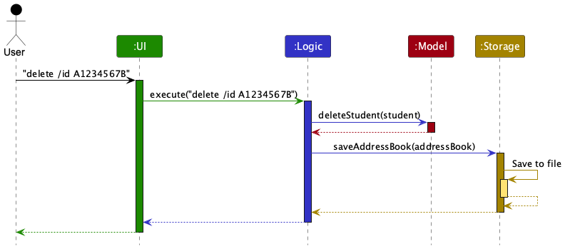

The `UI` forwards the command to `Logic`, which executes the corresponding operation against `Model`. After successful command execution, `Logic` requests `Storage` to persist the address book before returning the result to `UI`.

The diagram intentionally abstracts the internal parsing, command execution, and JSON serialization steps. These are explained in the component-specific sections.

### Component interfaces and implementations

Each major component exposes its functionality through an interface and provides a concrete manager implementation.

For example, `LogicManager` implements the `Logic` interface, while `ModelManager` and `StorageManager` implement `Model` and `Storage` respectively.

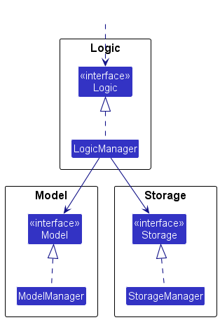

This separation allows components to depend on public APIs rather than the internal implementation of another component. It also supports testing by allowing alternative implementations of component interfaces.

## UI component

**API:** `Ui.java`

The `UI` component uses JavaFX to handle user interaction and display information maintained by TAssist.

The following class diagram illustrates the structure of the UI component.

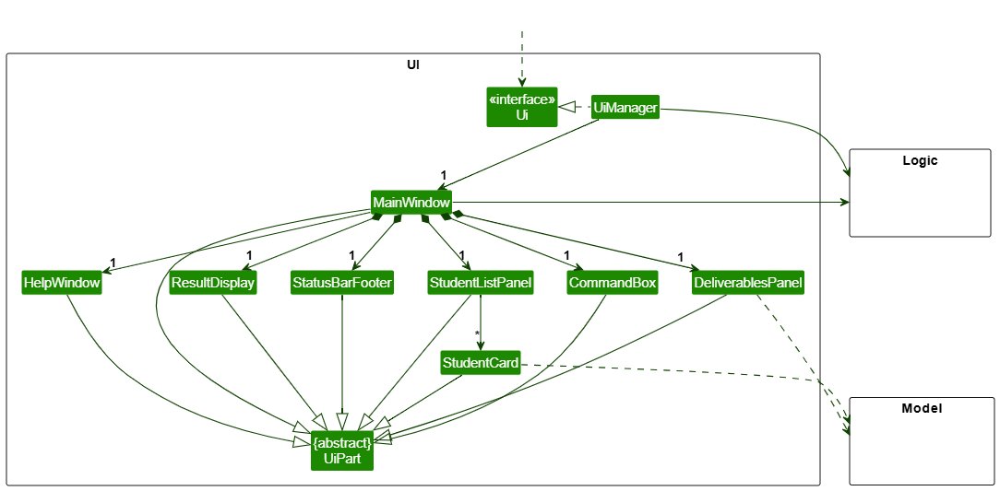

`UiManager` implements the `Ui` interface and manages the application's main window.

`MainWindow` coordinates several UI parts, including:

- `CommandBox`, which accepts user commands.
- `ResultDisplay`, which displays command feedback.
- `StudentListPanel`, which displays student records through `StudentCard` instances.
- `DeliverablesPanel`, which displays structured deliverable-progress information.
- `StatusBarFooter`, which displays application status information.
- `HelpWindow`, which provides command guidance.

These UI classes inherit from the abstract `UiPart` class, which provides shared functionality for JavaFX UI components.

UI layouts are defined using FXML resources, while their corresponding Java classes handle interaction and presentation logic.

The `UI` component communicates with `Logic` to execute commands and retrieve application data. It also uses Model types when rendering students and deliverable-progress information.

## Logic component

**API:** `Logic.java`

The `Logic` component interprets user commands, executes the corresponding operations, and returns their results.

The following class diagram shows the main structural relationships within Logic.

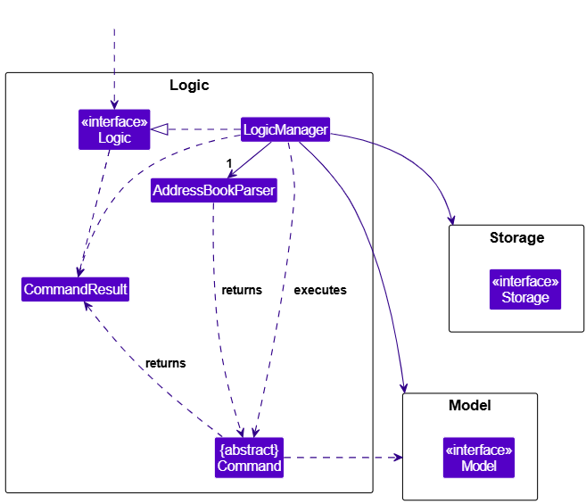

`LogicManager` implements the `Logic` interface and coordinates command execution.

It uses `AddressBookParser` to convert command text into a `Command` object. The command is then executed against `Model`, producing a `CommandResult`.

`LogicManager` also interacts with `Storage` to persist the address book after successful command execution.

### Command execution

The following sequence diagram illustrates the execution of `delete /id A1234567B`.

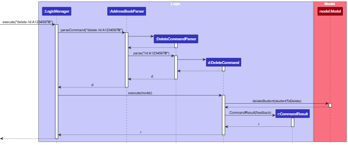

The command execution proceeds as follows:

1. `LogicManager` passes the command text to `AddressBookParser`.
2. `AddressBookParser` creates the appropriate command-specific parser, `DeleteCommandParser`.
3. `DeleteCommandParser` parses the arguments and creates a `DeleteCommand`.
4. `LogicManager` executes the returned command against `Model`.
5. `DeleteCommand` identifies the target student and invokes `Model.deleteStudent(...)`.
6. The command creates and returns a `CommandResult`.

The diagram focuses on the internal Logic execution path. Student lookup details, exception handling, and persistence are omitted to keep the interaction focused. Persistence is represented in the architecture sequence diagram.

### Command parsing

The parser subsystem separates command identification from command-specific argument parsing.

The following partial class diagram illustrates the shared parsing architecture.

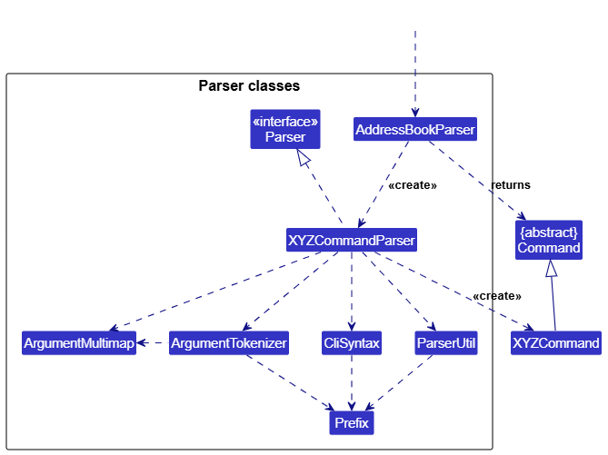

`AddressBookParser` identifies the command word and delegates argument parsing to the appropriate parser.

Command-specific parsers use shared infrastructure such as:

- `ArgumentTokenizer` to separate arguments into prefixed values.
- `ArgumentMultimap` to store and retrieve tokenized arguments.
- `ParserUtil` to validate and convert argument values.
- `CliSyntax` and `Prefix` to define command parameter syntax.

In the diagram, **`XYZCommandParser` and `XYZCommand` are representative placeholders**, not actual Java classes. They illustrate the general relationship between a command-specific parser and the command it creates. For example, `SearchCommandParser` creates a `SearchCommand`.

The diagram intentionally omits specialized parser inheritance relationships. For example, progress commands share parsing behavior through `StudentProgressCommandParser`, which is extended by `MarkCommandParser` and `UnmarkCommandParser`.

This design allows common parsing and validation behavior to be reused while retaining command-specific parsing responsibilities.

## Model component

**API:** `Model.java`

The `Model` component maintains TAssist's in-memory application data and provides operations for managing students, courses, enrolments, and deliverable progress.

The following class diagram illustrates its main structural relationships.

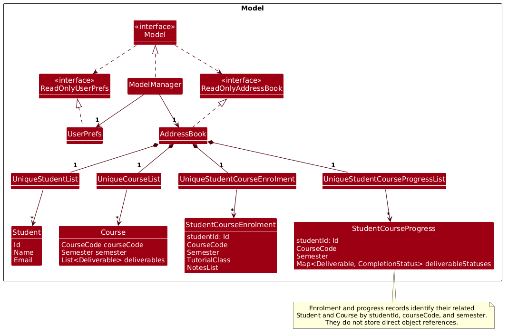

`ModelManager` implements the `Model` interface and maintains an `AddressBook` and a `UserPrefs` object.

`AddressBook` organizes domain records through four specialized collections:

| Collection | Stored records |
|---|---|
| `UniqueStudentList` | `Student` |
| `UniqueCourseList` | `Course` |
| `UniqueStudentCourseEnrolment` | `StudentCourseEnrolment` |
| `UniqueStudentCourseProgressList` | `StudentCourseProgress` |

These collection classes encapsulate record management and enforce uniqueness constraints.

The `Model` interface exposes read-only interfaces such as `ReadOnlyAddressBook` and `ReadOnlyUserPrefs`. This separates data access from the mutable operations provided by their concrete implementations.

The Model also maintains a filtered student list, exposed through an unmodifiable observable list. This allows the UI to observe changes without directly modifying the underlying student collection.

### Multiple course enrolments and independent progress

TAssist separates student identity from course enrolment and deliverable progress.

A `Student` represents a student independently of their course registrations. Each `StudentCourseEnrolment` identifies the student and a particular course-semester, while a corresponding `StudentCourseProgress` records completion statuses for that course's deliverables.

The following object diagram shows a concrete snapshot of one student enrolled in two courses.

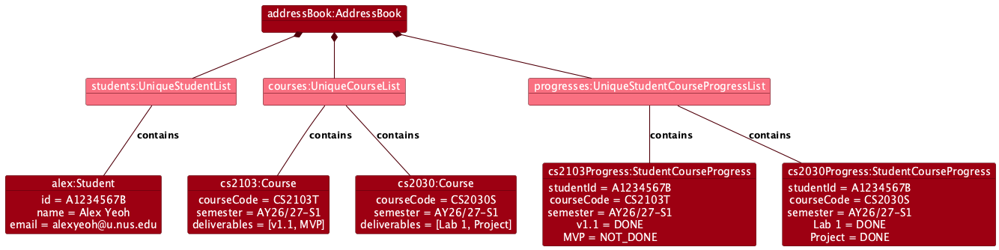

The snapshot demonstrates that:

- One student record can be associated with multiple enrolments.
- Each enrolment belongs to a particular course-semester.
- Each course defines its own deliverables.
- Progress is tracked independently for each student-course-semester combination.

The model uses identifying values such as student ID, course code, and semester to associate these records, rather than storing direct references between all domain entities.

This separation avoids duplicating student information across courses and allows progress to be maintained independently for each enrolment.

## Storage component

**API:** `Storage.java`

The `Storage` component manages the persistence of TAssist's address-book data and user preferences.

The following class diagram illustrates its structure.

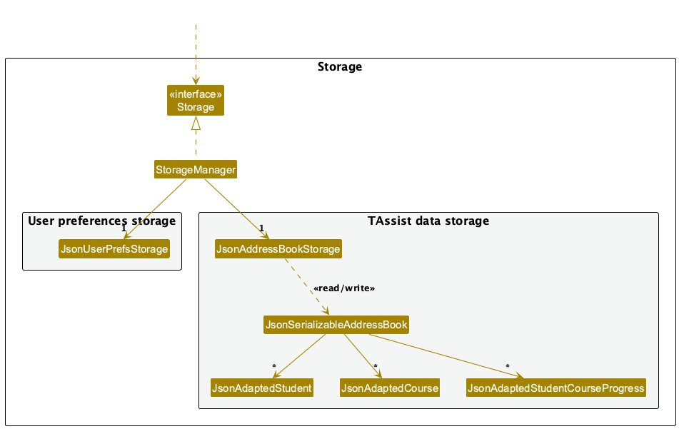

`StorageManager` implements the `Storage` interface and delegates file operations to two specialized storage classes:

- `JsonAddressBookStorage`, which manages address-book data.
- `JsonUserPrefsStorage`, which manages user preferences.

`JsonAddressBookStorage` uses `JsonSerializableAddressBook` to convert between JSON data and the Model representation.

The JSON representation includes adapters for students, courses, enrolments, and progress records.

### Loading address-book data

When TAssist starts, `MainApp` requests the saved address book through `StorageManager`.

The following sequence diagram illustrates the successful loading interaction.

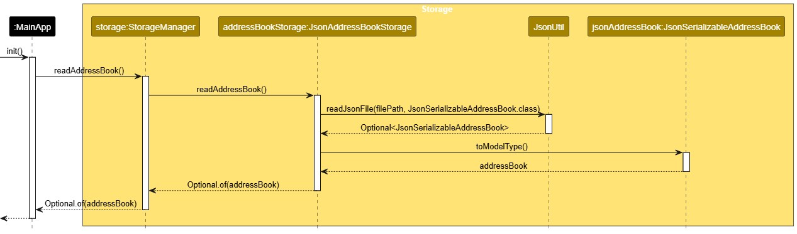

`StorageManager` delegates loading to `JsonAddressBookStorage`, which uses `JsonUtil` to deserialize the JSON file into `JsonSerializableAddressBook`.

The deserialized data is then converted into an `AddressBook` through `toModelType()`, which validates the persisted records and their relationships.

The sequence diagram intentionally focuses on successful object collaboration. Missing files, invalid data, and startup failure handling are explained separately below.

### Storage loading outcomes

TAssist distinguishes a missing data file from an existing file that cannot be loaded safely.

The following activity diagram summarizes the startup outcomes.

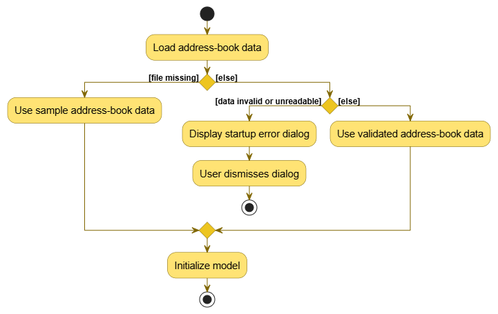

| Storage condition | Behaviour |
|---|---|
| Address-book file is missing | Initialize the application with sample data. |
| Existing file is valid | Load the saved address book. |
| Existing file contains reconcilable progress differences | Reconcile and persist the corrected progress before normal startup. |
| Existing file is malformed or contains invalid records | Reject loading and stop normal startup. |
| Existing file cannot be read | Stop normal startup and report the loading failure. |

An invalid existing file is **never treated as a missing file**.

This distinction prevents TAssist from silently replacing user data with sample data when loading fails.

When loading fails, TAssist displays a JavaFX error dialog and exits after the user dismisses it. Normal command execution is not initialized, preventing subsequent commands from overwriting the invalid address-book file.

### Progress reconciliation

TAssist applies a limited reconciliation policy to progress records whose deliverables differ from those currently defined by their course.

The following activity diagram illustrates the reconciliation workflow and its persistence safeguards.

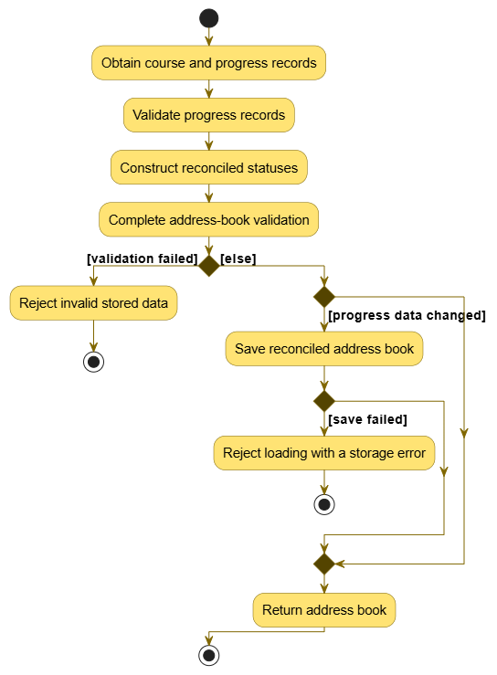

During conversion, progress statuses are aligned with the deliverables defined by the corresponding course.

| Situation | Reconciliation behaviour |
|---|---|
| Stored deliverable matches a course deliverable | Preserve its existing completion status. |
| Course deliverable is missing from progress | Add it with status `NOT_DONE`. |
| Stored progress contains an unknown deliverable | Exclude it from the reconciled record. |
| Deliverable differs only in capitalization | Match case-insensitively and preserve its status. |
| Progress records are already consistent | Do not unnecessarily rewrite the storage file. |

For example, suppose a course defines `MVP` and `Final`, but the saved progress contains:

```json
{
  "mvp": "DONE",
  "Old": "NOT_DONE"
}
```

The reconciled progress becomes:

```json
{
  "MVP": "DONE",
  "Final": "NOT_DONE"
}
```

The valid `MVP` status is preserved, the missing `Final` status is initialized as `NOT_DONE`, and the obsolete `Old` entry is excluded.

Reconciliation is tracked during conversion, and the final reconciliation state is recorded only after successful validation.

The activity diagram separates validation and reconciliation into conceptual actions for readability. In the implementation, some validation occurs while individual progress records are being reconciled.

**Reconciliation is not a general corruption-recovery mechanism.** Invalid references, duplicate records, invalid notes, and malformed data are rejected rather than silently corrected.

### Persistence safety and failure handling

Reconciled data is saved only after successful model conversion and validation.

If no reconciliation is required, the existing address-book file is not unnecessarily rewritten.

TAssist also uses a temporary-file write strategy to reduce the risk of corrupting existing data during saving:

1. Write the new JSON content to a temporary file in the target directory.
2. Replace the original file after the temporary content has been written successfully.
3. Use atomic replacement where supported, with a non-atomic replacement fallback where necessary.
4. Clean up temporary files after failures where possible.

If saving reconciled data fails, loading reports a `DataLoadingException` instead of treating persistence as successful.

The non-atomic fallback cannot guarantee protection against every interruption. Likewise, reconciliation may intentionally discard completion statuses associated with unknown deliverables, because TAssist cannot safely infer how an obsolete deliverable maps to a current one.

These behaviors are deliberate storage policies that future developers should preserve or explicitly reconsider when modifying persistence logic.

---

# Implementation

This section explains noteworthy TAssist-specific workflows and the design decisions behind them.

## Course initialisation

The `init course` command establishes the course-semester and deliverable definitions used by subsequent enrolment and progress-tracking operations.

`InitCourseCommandParser` parses the course code, semester, and requested deliverables before constructing an `InitCourseCommand`.

A course is identified by its `CourseCode` and `Semester`. Its deliverables define the milestones against which student progress is tracked.

`UniqueCourseList` prevents duplicate course-semester records, while the Model API provides operations such as `hasCourse()` and `addCourse()`.

Persisting course definitions alongside the other address-book records ensures that course information remains available after restarting TAssist.

## Updating deliverable progress

`MarkCommand` and `UnmarkCommand` share their execution workflow through `StudentProgressCommand`.

The commands differ in the target completion status:

- `mark` updates requested deliverables to `DONE`.
- `unmark` updates requested deliverables to `NOT_DONE`.

The following activity diagram illustrates the shared workflow.

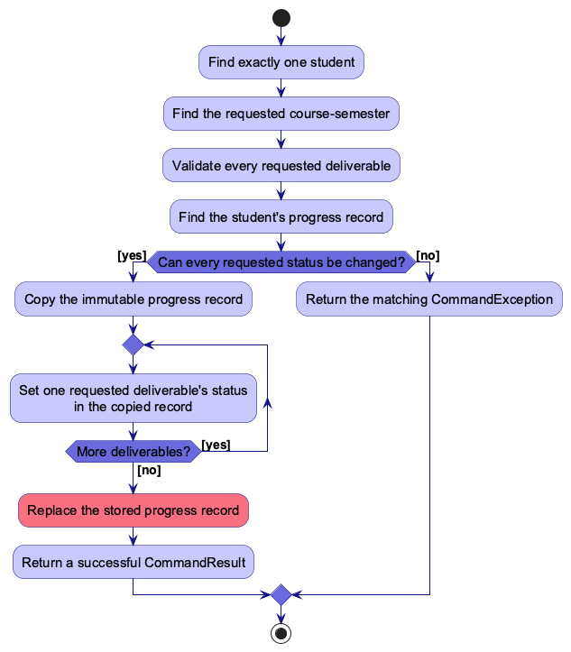

The command first identifies exactly one student and the requested course-semester. It then validates the requested deliverables, retrieves the matching progress record, and checks its current completion statuses.

`StudentCourseProgress` is immutable. Therefore, the command uses `withStatus(...)` to construct updated progress records rather than mutating the existing stored record.

Only after all required checks and updates succeed does the command replace the original record through the Model API.

This ensures that failed validation does not leave a partially updated progress record in the Model.

The diagram combines the validation outcomes into a single decision for readability. In the actual implementation, a failed lookup or validation throws `CommandException` immediately.

## Viewing student deliverables

The `view` command retrieves the deliverable progress associated with a selected student across their enrolled course-semesters.

`ViewProgressCommand` identifies the student and collects matching `StudentCourseProgress` records.

For students with available progress records, the command constructs a `StudentDeliverablesView` containing the selected student and an immutable list of their progress records.

The view is included in `CommandResult`, alongside the textual feedback.

The following sequence diagram illustrates how this structured result reaches the UI.

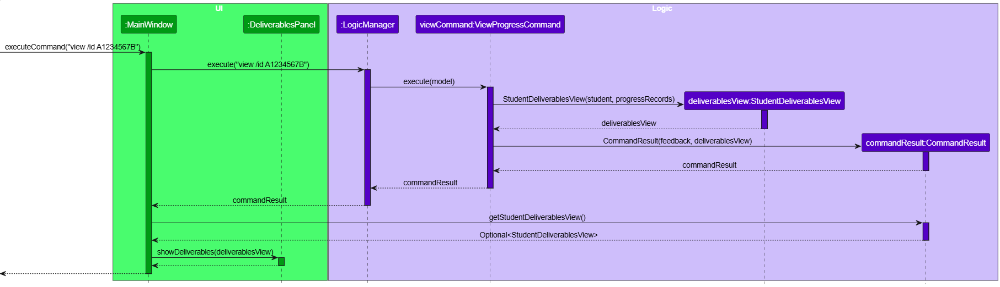

`MainWindow` receives the `CommandResult` from Logic and retrieves its optional `StudentDeliverablesView` payload.

When the payload is present, `MainWindow` passes it to `DeliverablesPanel` through `showDeliverables(...)`.

The diagram illustrates a successful view operation with progress records. Parser interactions, Model lookups, Storage persistence, student-list scrolling, and the empty-progress case are intentionally omitted to focus on the structured-result handoff.

### Design consideration: structured UI data

Two approaches were considered for passing deliverable information to the UI.

| Approach | Advantage | Drawback |
|---|---|---|
| Parse formatted command feedback in the UI | Avoids introducing another result type | Couples UI behavior to the wording and formatting of feedback messages |
| Include a structured view in `CommandResult` | Provides strongly typed data independent of feedback formatting | Requires an additional view representation |

TAssist uses the second approach.

This separates the textual feedback shown in `ResultDisplay` from the structured progress data consumed by `DeliverablesPanel`.

As a result, changes to feedback wording do not require the panel to change how it interprets deliverable information.

---

# Common classes

Classes shared by multiple components are located in the `seedu.address.commons` package.

These include utilities and common types supporting logging, file operations, exception handling, and application configuration.

Keeping shared functionality in Commons avoids duplicating cross-cutting infrastructure within the individual components. 

--------------------------------------------------------------------------------------------------------------------

## **Documentation, logging, testing, dev-ops**

* [Documentation guide](Documentation.md)
* [Testing guide](Testing.md)
* [Logging guide](Logging.md)
* [DevOps guide](DevOps.md)

--------------------------------------------------------------------------------------------------------------------

## **Appendix: Requirements**

### Product scope

**Target user profile**:

The target users of TAssist are university teaching assistants who:

* supervise a significant number of students across one or more tutorial classes
* oversee at least one multi-week programming project
* need to track student information and project progress over an extended period
* frequently search for and update student records
* prefer using a desktop application to manage their records
* are comfortable typing commands and using keyboard-based interactions

**Value proposition**:

The platform helps TAs efficiently track students’ attendance, participation, weaknesses, stress levels and past interactions. It also helps TAs monitor students’ project progress and record their design decisions for programming assignments.

By centralising this information, the platform allows TAs to recall previous interactions, monitor project progress and provide more contextualised support to students.


### User stories

Priorities: High (must have) - `***`, Medium (nice to have) - `**`,
Low (unlikely to have) - `*`

| Priority | As a … | I want to … | So that I can … |
| -------- | ------ | ------------ | --------------- |
| `***` | TA | view all students under my supervision | keep track of the students I manage |
| `***` | TA | add a student with their name, student ID, email address and tutorial class | maintain accurate student records |
| `***` | TA | search for a student by name or student ID | quickly retrieve the relevant student’s information |
| `***` | TA | update a student’s details | keep student information up to date |
| `***` | TA | delete a student who is no longer under my supervision | maintain an up-to-date student list |
| `***` | TA | initialise a course and its project deliverables for a semester | begin tracking students’ progress for that course |
| `***` | TA | view students’ project deliverables and completion statuses | understand and compare their progress |
| `***` | TA | mark a student’s project deliverable as completed | record the student’s progress |
| `***` | TA | unmark a completed project deliverable | correct the student’s progress record when necessary |
| `**` | TA | add a note about a student’s project work | record observations about the student’s progress or implementation |
| `**` | TA | view a student’s project-work notes | recall previous observations and interactions |
| `**` | TA | edit a student’s project-work note | correct or update information when necessary |
| `**` | TA | delete an outdated or incorrect project-work note | keep the student’s record accurate |
| `**` | TA | record a student’s attendance | identify students who may require additional support |
| `**` | TA | record a student’s participation | monitor the student’s engagement during tutorials |
| `**` | TA | record a student’s weaknesses | provide more targeted guidance |
| `**` | TA | record a student’s technical strengths | build on what the student already understands when offering guidance |
| `**` | TA | record a student’s stress level | identify students who may need additional support |
| `**` | TA | record my past interactions with a student | provide support based on previous discussions |
| `**` | TA | view students in a selected tutorial class | prepare for a specific tutorial session |
| `**` | TA | view a student’s attendance history | identify participation patterns over time |
| `**` | TA | categorise interaction notes by programming topic | identify a student’s recurring technical difficulties more quickly |
| `**` | TA | view all students flagged for follow-up | prioritise students who need additional support |
| `**` | TA | mark a follow-up as completed | know which support actions no longer need attention |
| `*` | TA | record a student’s important project design decisions | understand the reasoning behind the student’s implementation |
| `*` | TA | view a student’s project history | understand how the student’s project has developed over time |
| `*` | student | view my own project progress | understand which deliverables I have completed |
| `*` | student | update my own personal information | keep my information up to date |
| `*` | TA | generate a report of student progress | review or share an overview of student performance |
| `*` | TA | send notifications to students through the application | communicate important information conveniently |

### Use cases

**Actor** is the `TA`, unless specified otherwise.

---

**Use case: Add a student**

**MSS**

1. TA requests to add a student.
2. TAssist prompts the TA for the student's name, student ID, email address, course, semester, and tutorial class.
3. TA enters the required student information.
4. TAssist validates the entered information.
5. TAssist adds the student record.
6. TAssist displays a confirmation message and the updated student list.

   Use case ends.

**Extensions**

* 3a. One or more required fields are missing.

  * 3a1. TAssist displays an error message.

  * 3a2. TA enters the missing information.

    Use case resumes at step 4.

* 4a. The student ID is already in use.

  * 4a1. TAssist displays an error message.

    Use case resumes at step 3.

* 4b. The email address is invalid.

  * 4b1. TAssist displays an error message.

    Use case resumes at step 3.

* 4c. The course for the given semester does not exist.

  * 4c1. TAssist displays error message asking to initialise course for the given semester first.

    Use case resumes at step 3.

---

**Use case: Search for a student**

**MSS**

1. TA requests to search for a student.
2. TAssist prompts the TA for a student name or student ID.
3. TA enters a search term.
4. TAssist searches the student records.
5. TAssist displays the matching student records.

   Use case ends.

**Extensions**

* 4a. No matching student is found.

  * 4a1. TAssist displays an appropriate message.

    Use case ends.

* 4b. Multiple students have the same name.

  * 4b1. TAssist displays all matching students and their student IDs.

    Use case ends.

---

**Use case: Initialise a course and its project deliverables**

**MSS**

1. TA requests to initialise a course for a specified semester with a list of project deliverables.
2. TAssist validates the course, semester and deliverable details.
3. TAssist creates the course record and its project deliverables.
4. TAssist displays a confirmation.

   Use case ends.

**Extensions**

* 2a. One or more supplied details are invalid.

  * 2a1. TAssist displays an error message.

    Use case resumes at step 1.

* 3a. A record for the same course and semester already exists.

  * 3a1. TAssist displays an error message.

    Use case ends.

---

**Use case: Record a project-work note**

**Preconditions**: The student is recorded in TAssist.

**MSS**

1. TA requests to add a project-work note for a specific student.
2. TAssist validates the student and note details.
3. TAssist saves the note in the student's record.
4. TAssist displays a confirmation.

   Use case ends.

**Extensions**

* 2a. The student cannot be found or the note is invalid.

  * 2a1. TAssist displays an error message.

    Use case resumes at step 1.

---

**Use case: Update a student's deliverable completion status**

**Preconditions**: The student, course, semester, and specified deliverables are
recorded in TAssist.

**MSS**

1. TA requests to mark or unmark specified project deliverables for a student in
   a course and semester.
2. TAssist validates the student, course, semester, and deliverable details.
3. TAssist finds the student's deliverable-progress record for the specified
   course and semester.
4. TAssist updates the deliverables' completion statuses.
5. TAssist displays the updated completion statuses.

   Use case ends.

**Extensions**

* 2a. The student, course, semester, or deliverable cannot be found.

  * 2a1. TAssist displays an error message.

    Use case resumes at step 1.

* 3a. No deliverable-progress record exists for the student, course, and semester.

  * 3a1. TAssist displays an error message.

    Use case resumes at step 1.

* 4a. A requested completion status is already recorded.

  * 4a1. TAssist informs the TA that no change was made.

    Use case ends.

### Non-Functional Requirements

1.  TAssist should work on Windows, macOS and Linux, as long as Java `25` or above is installed.
2.  TAssist should support up to 1,000 student records without noticeable sluggishness during typical usage.
3.  For up to 1,000 student records, TAssist should display student search results and a selected course's deliverable completion statuses within two seconds.
4.  A TA with above-average typing speed for regular English text should be able to accomplish frequent deliverables faster using commands than using the mouse.
5.  An invalid command should not modify existing student records, project-work notes or deliverable completion statuses.
6.  Student records, project-work notes and deliverable completion statuses should be preserved after a normal application exit and restart.

### Glossary

* **Attendance record**: A record of whether a student attended a
  particular tutorial session.

* **Completion status**: Whether a student has completed a particular
  project deliverable.

* **Course**: A university course tracked in TAssist for a specified
  semester.

* **Follow-up**: A support action a TA intends to take for a student,
  which can be marked as completed after it is addressed.

* **Interaction note**: A record of a past discussion or interaction
  between a TA and a student.

* **Participation record**: A record of a student's engagement during a
  tutorial session.

* **Project design decision**: A recorded decision about how a student
  chose to design or implement part of their project.

* **Project deliverable**: A required part or milestone of a course
  project that a student is expected to complete.

* **Project history**: A chronological record of a student's progress,
  notes, and relevant changes made during a course project.

* **Project-work note**: A note recorded by a TA about a student's
  project progress, implementation, or difficulties.

* **Stress level**: A TA's recorded assessment of a student's apparent
  level of stress. The team should later define the allowed levels.

* **Student record**: The information TAssist stores for one student,
  including their personal details, tutorial class, and tracked progress.

* **TA**: A university teaching assistant who uses TAssist to manage
  students and monitor their project progress.

* **Technical strength**: A programming-related area in which a student
  demonstrates competence.

* **Technical weakness**: A programming-related area in which a student
  needs additional support.

* **Tutorial class**: A class group supervised by one or more TAs.

--------------------------------------------------------------------------------------------------------------------

## **Appendix: Instructions for manual testing**

Given below are instructions to test the app manually.

<div markdown="span" class="alert alert-info">:information_source: **Note:** These instructions only provide a starting point for testers to work on;
testers are expected to do more *exploratory* testing.

</div>

### Launch and shutdown

1. Initial launch

   1. Download the JAR file and copy it into an empty folder.

   1. Double-click the JAR file.<br>
      Expected: The GUI opens with a set of sample contacts. The window size may not be optimal.

1. Saving window preferences

   1. Resize the window to an optimal size. Move the window to a different location. Close the window.

   1. Relaunch the app by double-clicking the JAR file.<br>
       Expected: The most recent window size and location are retained.

1. _{ more test cases …​ }_

### Deleting a student

1. Deleting a student while all students are being shown

   1. Prerequisites: List all students using the `list` command, with multiple students in the list.

   1. Test case: `delete /id A1234567B`<br>
      Expected: Alex Yeoh is deleted from the list. The status message shows the deleted student's details.

   1. Test case: `delete /name Bernice Yu`<br>
      Expected: Bernice Yu is deleted from the list. The status message shows the deleted student's details.

   1. Other incorrect delete commands to try: `delete`, `delete /id`, and `delete /unknown value`.<br>
      Expected: No student is deleted. The status message shows the relevant error details.

1. _{ more test cases …​ }_

### Saving data

1. Dealing with corrupted data files

   1. Prerequisites: Place `TAssist.jar` in an empty folder. Ensure there is no data folder inside this folder.
   2. Open a terminal and navigate to the folder containing `TAssist.jar`.
   3. Run `java -jar TAssist.jar` to launch the app.
   4. Add a project-work notes using
   `notes /id A1234567B /course CS2103T /sem AY26/27-S1 /deliverable MVP /notes Implemented add and delete but not edit`. Alex Yeoh's display should now say `2 notes`.
   5. In the folder with `TAssist.jar`, a new data folder is created. Open `addressbook.json` located in the data folder.
   6. Scroll down to enrolments and edit `"studentId" : "A1234567B",` to `"studentId" : ,`
   7. Rerun `java -jar TAssist.jar` in your terminal to launch the app.
   8. Expected: The app will launch with the sample data loaded instead of the corrupted data. Alex Yeoh's display will now show `1 notes` instead.
   9. Restore the data file by editing `"studentId" : ,` back to `"studentId" : "A1234567B",`.
   10. Relaunching the app using `java -jar TAssist.jar` in your terminal will load the correct data. You can verify this by running `view notes /id A1234567B /course CS2103T /sem AY26/27-S1`
