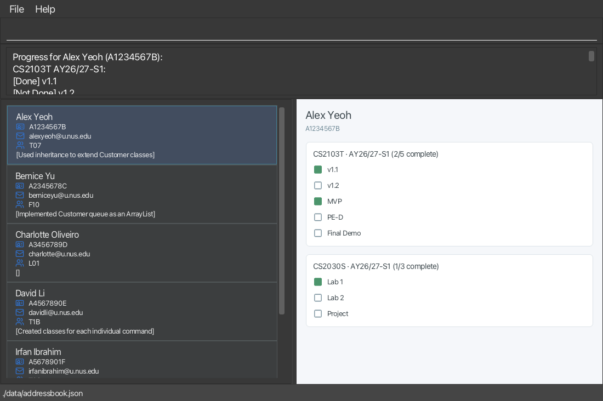

TAssist is a **desktop application for managing students, optimized for use through a Command Line Interface (CLI)** while retaining the benefits of a Graphical User Interface (GUI).

* Table of Contents
{:toc}

--------------------------------------------------------------------------------------------------------------------

## Quick start

1. Ensure that Java `25` or later is installed on your computer. 
   **Mac users:** Ensure you have the precise JDK version prescribed [here](https://se-education.org/guides/tutorials/javaInstallationMac.html).

1. Download the latest `.jar` file from [here](https://github.com/se-edu/addressbook-level3/releases).

1. Copy the file to the folder you want to use as the _home folder_ for your AddressBook.

1. Open a terminal, `cd` to the folder containing the JAR file, and run `java -jar addressbook.jar`. 
   A GUI similar to the one below should appear in a few seconds. Note how the app contains some sample data. 
   

1. Type a command in the command box and press Enter to execute it. For example, type **`help`** and press Enter to open the help window. 
   Some example commands you can try:

   * `list` : Lists all students.

   * `add /name John Doe /id A1234567Z /email johndoe@u.nus.edu /course CS2103T /sem AY26/27-S1 /class T07` : Adds a student with an initial course enrolment.

   * `delete /id A1234567Z` : Deletes the student with the specified ID.

   * `clear` : Deletes all students.

   * `exit` : Exits the app.

1. Refer to the [Features](#features) section below for details of each command.

--------------------------------------------------------------------------------------------------------------------

## Features

**:information_source: Notes about the command format:** 

* Words in `UPPER_CASE` are the parameters to be supplied by the user. 
  For example, in `add /name NAME`, replace `NAME` with a value such as `John Doe`.

* Items in square brackets are optional. 
  The optional parameters shown in each command's format may be omitted.

* Items followed by `…`​ can appear zero or more times. 
  For example, `[t/TAG]…​` may be omitted, or written as `t/friend` or `t/friend t/family`.

* Parameters can be in any order unless a command explicitly documents an ordering requirement. 
  The `/notes` parameter for the `notes` command must be the final parameter because its value is free text.

* Commands reject unsupported or extraneous parameters with an error message. Commands such as `help`, `exit`, and
  `clear` do not take parameters, while `list` also rejects unexpected text or parameters.

* If you are using a PDF version of this document, be careful when copying and pasting commands that span multiple lines as space characters surrounding line-breaks may be omitted when copied over to the application.

### Viewing help: `help`

Shows a message explaining how to access the help page.

Format: `help`

### Adding a student: `add`

Adds a student to the address book.

Format: `add /name NAME /id ID /email EMAIL /course COURSE[, COURSE]... /sem SEMESTER[, SEMESTER]... /class CLASS[, CLASS]...`

The course, semester and tutorial-class values are matched by position. At least
one complete enrolment is required. The referenced course-semester must already
have been initialised with `init course`.

Examples:
* `add /name John Doe /id A1234567Z /email johndoe@u.nus.edu /course CS2103T /sem AY26/27-S1 /class T07`

Multiple enrolments can be added in one command:

* `add /name John Doe /id A1234567Z /email johndoe@u.nus.edu /course CS2103T, IS2108 /sem AY26/27-S1, AY26/27-S1 /class T07, T02`

### Initialising a course: `init course`

Initialises one course for a semester and records its project deliverables. A course can be initialised only once
per semester, regardless of letter case. Provide at least one unique deliverable and separate deliverable names with
commas.

Format: `init course /course COURSE_CODE /sem SEMESTER /deliverable DELIVERABLE[, DELIVERABLE]...`

Example: `init course /course CS2103T /sem AY26/27-S1 /deliverable v1.2, MVP, PE-D`

### Listing all students: `list`

Shows a list of all students in the address book.

Format: `list`

### Editing a student: `edit`

Edits the details of an existing student identified by their current student ID.

Format: `edit /id CURRENT_ID [/name NEW_NAME] [/newid NEW_ID] [/email NEW_EMAIL]`

* `/id CURRENT_ID` is **required** and identifies the student whose details are to be edited.

* At least one of the optional fields (`/name`, `/newid`, `/email`) must be provided.

* Only the specified fields will be updated. All unspecified fields, including existing project notes, will remain unchanged.

* `/newid` allows the student's ID to be updated, while `/id` identifies the existing student.

* The updated student ID and email address must not conflict with those of another student.

* If all provided values are identical to the student's existing details, no changes will be made and the user will be notified.

* If some provided values are unchanged, the remaining valid changes will still be applied. The application will indicate which fields were changed and which were already up to date.

Examples:
* `edit /id A1234567Z /email johndoe@u.nus.edu` Updates the email address of the student with ID `A1234567Z` to `johndoe@u.nus.edu`.

* `edit /id A1234567Z /name John Tan /email johntan@u.nus.edu`
Updates the student's name and email address.

* `edit /id A1234567Z /newid A7654321B`
Changes the student's ID from `A1234567Z` to `A7654321B`.

* `edit /id A1234567Z /newid A7654321B /email johntan@u.nus.edu`
Updates both the student's ID and email address.

### Managing course enrolments: `enrol`, `unenrol`

Use `enrol` to add an existing student to another course-semester. The course
must have been initialised first.

Format: `enrol /id ID /course COURSE /sem SEMESTER /class CLASS`

Example:

* `enrol /id A1234567Z /course IS2108 /sem AY26/27-S1 /class T02`

Use `unenrol` to remove one course-semester enrolment. Its deliverable progress
is removed as well. If it was the student's final enrolment, the student record
is removed too.

Format: `unenrol /id ID /course COURSE /sem SEMESTER`

Example:

* `unenrol /id A1234567Z /course IS2108 /sem AY26/27-S1`

### Locating students by name: `find`

Finds students whose names contain any of the given keywords.

Format: `find KEYWORD [MORE_KEYWORDS]`

* The search is case-insensitive; for example, `hans` matches `Hans`.
* Keyword order does not matter; for example, `Hans Bo` matches `Bo Hans`.
* The search considers only names.
* Only full words match; for example, `Han` does not match `Hans`.
* Students matching at least one keyword are returned (an `OR` search); for example, `Hans Bo` returns `Hans Gruber` and `Bo Yang`.

Examples:
* `find John` returns `john` and `John Doe`
* `find alex david` returns `Alex Yeoh`, `David Li` 
  

### Searching students by name or ID: `search`

Searches student records by a case-insensitive name fragment or an exact student ID.

Format: `search /name NAME` or `search /id ID`

Examples:

* `search /name John Doe` shows students whose names contain `John Doe`.
* `search /id A1234567Z` shows the student with ID `A1234567Z`.

Only one of `/name` and `/id` may be supplied. The command rejects missing, repeated, or unknown parameters.
Student ID matching is case-insensitive.

### Managing student notes: `notes`, `view notes`, `delete notes`

Add, view, or delete the notes recorded for a student. Use the student's unique ID to avoid ambiguity.

Formats:

* `notes /id ID /course COURSE /sem SEMESTER /deliverable DELIVERABLE /notes NOTES`
* `view notes /id ID /course COURSE /sem SEMESTER`
* `delete notes /id ID /course COURSE /sem SEMESTER`

The `/notes` value consumes the remaining text. Standalone slash-prefixed parameter-like
tokens after `/notes` are rejected to prevent malformed commands from being treated as note text.

Examples:

* `notes /id A1234567Z /course CS2103T /sem AY26/27-S1 /deliverable MVP /notes Struggled with inheritance during consultation` adds a note to the selected enrolment.
* `view notes /id A1234567Z /course CS2103T /sem AY26/27-S1` displays notes for the selected enrolment.
* `delete notes /id A1234567Z /course CS2103T /sem AY26/27-S1` deletes notes for the selected enrolment.

### Marking deliverables as complete: `mark`

Marks one or more deliverables as complete for a student in a course-semester.

Format: `mark /id ID /course COURSE /sem SEMESTER /deliverable DELIVERABLE[, DELIVERABLE]...` or
`mark /name NAME /course COURSE /sem SEMESTER /deliverable DELIVERABLE[, DELIVERABLE]...`

Examples:

* `mark /id A1234567Z /course CS2103T /sem AY26/27-S1 /deliverable MVP`
* `mark /name John Doe /course CS2103T /sem AY26/27-S1 /deliverable v1.1, MVP`

Use `/id` when several students have the same name. Every deliverable must belong to
the specified course-semester and must currently be Not Done.

### Marking deliverables as incomplete: `unmark`

Marks one or more completed deliverables as incomplete for a student in a
course-semester.

Format: `unmark /id ID /course COURSE /sem SEMESTER /deliverable DELIVERABLE[, DELIVERABLE]...` or
`unmark /name NAME /course COURSE /sem SEMESTER /deliverable DELIVERABLE[, DELIVERABLE]...`

Examples:

* `unmark /id A1234567Z /course CS2103T /sem AY26/27-S1 /deliverable MVP`
* `unmark /name John Doe /course CS2103T /sem AY26/27-S1 /deliverable v1.1, MVP`

### Viewing a student's deliverable progress: `view`

Shows every deliverable and its completion status for one student across all
their course-semester enrolments. The deliverables panel expands to display
the grouped progress details.

Format: `view /id ID` or `view /name NAME`

Examples:

* `view /id A1234567Z`
* `view /name John Doe`

Use `/id` when several students have the same name. The result lists each
deliverable as `Done` or `Not Done` in the order it was initialised.

### Deleting a student: `delete`

Deletes a student from TAssist.

Format: `delete /id ID` or `delete /name NAME`

* Use `/id` to delete a student by their unique student ID.
* Use `/name` only when the name identifies one student. If more than one student
  has that name, use the student's ID instead.

Examples:
* `delete /id A1234567Z` deletes the student with ID `A1234567Z`.
* `delete /name John Doe` deletes John Doe when there is exactly one such student.

### Clearing all entries: `clear`

Clears all entries from the address book.

Format: `clear`

### Exiting the program: `exit`

Exits the program.

Format: `exit`

### Saving the data

AddressBook automatically saves data after every command. You do not need to save manually.

### Editing the data file

AddressBook data is saved automatically as a JSON file `[JAR file location]/data/addressbook.json`. Advanced users are welcome to update data directly by editing that data file.

**Legacy save files:** The enrolment-based data format is not compatible with older save files that stored tutorial classes or notes directly on students. If TAssist reports that an old save format was detected, first back up the file, then delete or replace `data/addressbook.json` with a compatible backup before restarting. This avoids silently losing course-specific data.

:exclamation: **Caution:**
If your changes make the data file invalid, AddressBook starts with an empty address book at the next run. The invalid file remains on disk until you run a command (AddressBook saves after every command). Still, we recommend backing up the file before editing it. 
Furthermore, certain edits can cause the AddressBook to behave in unexpected ways (e.g., if a value entered is outside of the acceptable range). Therefore, edit the data file only if you are confident that you can update it correctly.

### Archiving data files `[coming in v2.0]`

_Details coming soon ..._

--------------------------------------------------------------------------------------------------------------------

## FAQ

**Q**: How do I transfer my data to another computer? 
**A**: Install the app on the other computer and overwrite the data file it creates with the data file from your previous AddressBook home folder.

--------------------------------------------------------------------------------------------------------------------

## Known issues

1. **When using multiple screens**, if you move the application to a secondary screen, and later switch to using only the primary screen, the GUI will open off-screen. The remedy is to delete the `preferences.json` file created by the application before running the application again.
2. **If you minimize the Help Window** and then run the `help` command (or use the `Help` menu, or the keyboard shortcut `F1`) again, the original Help Window will remain minimized, and no new Help Window will appear. The remedy is to manually restore the minimized Help Window.

--------------------------------------------------------------------------------------------------------------------

## Command summary

Action | Format, Examples
--------|------------------
**Add** | `add /name NAME /id ID /email EMAIL /course COURSE[, COURSE]... /sem SEMESTER[, SEMESTER]... /class CLASS[, CLASS]...`
**Clear** | `clear`
**Delete** | `delete /id ID` or `delete /name NAME`  e.g., `delete /id A1234567Z`
**Edit** | `edit /id CURRENT_ID [/name NEW_NAME] [/newid NEW_ID] [/email NEW_EMAIL]`
**Find** | `find KEYWORD [MORE_KEYWORDS]`  e.g., `find James Jake`
**Search** | `search /name NAME` or `search /id ID`  e.g., `search /id A1234567Z`
**Mark** | `mark /id ID /course COURSE /sem SEMESTER /deliverable DELIVERABLE[, DELIVERABLE]...`  e.g., `mark /id A1234567Z /course CS2103T /sem AY26/27-S1 /deliverable MVP`
**Unmark** | `unmark /id ID /course COURSE /sem SEMESTER /deliverable DELIVERABLE[, DELIVERABLE]...`  e.g., `unmark /id A1234567Z /course CS2103T /sem AY26/27-S1 /deliverable MVP`
**View progress** | `view /id ID` or `view /name NAME`  e.g., `view /id A1234567Z`
**List** | `list`
**Initialise course** | `init course /course COURSE_CODE /sem SEMESTER /deliverable DELIVERABLE[, DELIVERABLE]...`  e.g., `init course /course CS2103T /sem AY26/27-S1 /deliverable v1.2, MVP`
**Enrol** | `enrol /id ID /course COURSE /sem SEMESTER /class CLASS`  e.g., `enrol /id A1234567Z /course IS2108 /sem AY26/27-S1 /class T02`
**Unenrol** | `unenrol /id ID /course COURSE /sem SEMESTER`  e.g., `unenrol /id A1234567Z /course IS2108 /sem AY26/27-S1`
**Help** | `help`
